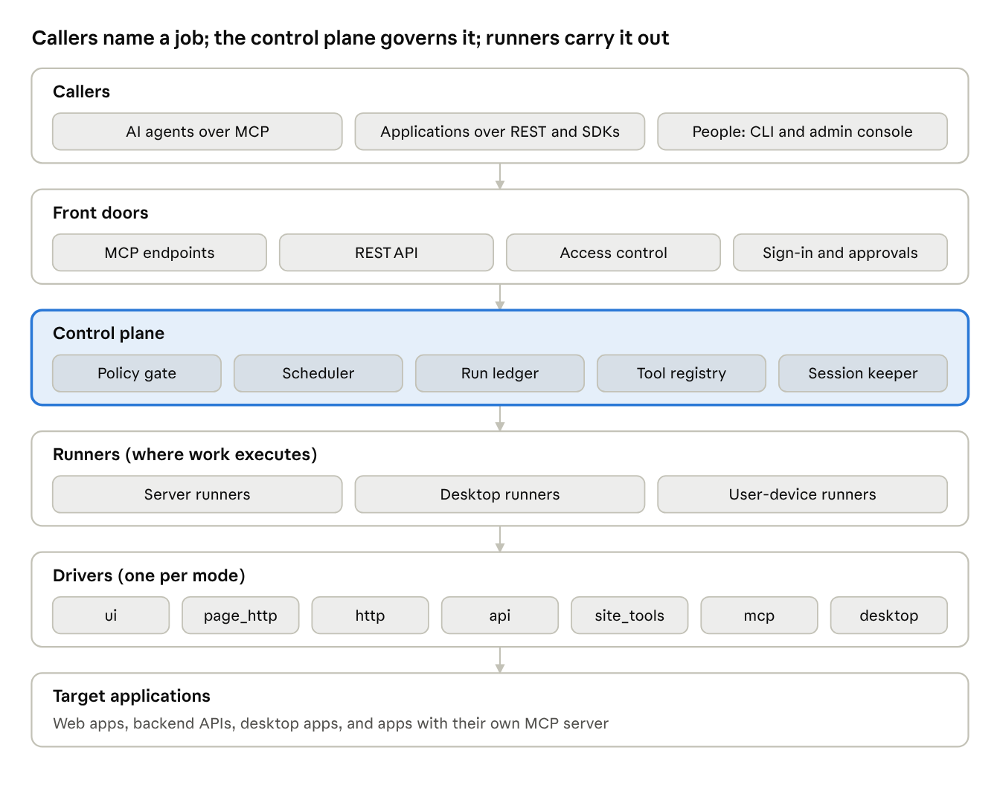

# 4. System overview

> Archived on 2026-11-17. This is section 4 of the first design, kept as it was written, with the names and numbers of its time. What it says now lives in [section 104, System overview](../../spec/1-product/104-system-overview.md).

The system has six layers. In the smallest setup all six run inside one process on a laptop; in the largest, the control plane and runners are separate services on separate machines. The layers and their contracts are the same either way.

| Layer | Responsibility | Knows about a specific app? |
| --- | --- | --- |
| Front doors | Speak MCP and REST, authenticate callers, serve the sign-in and approval pages | No |
| Control plane | Decide whether a call may run, queue it, record it, pick a runner, keep sessions alive | Only through published target files |
| Runners | Execute steps; hold the live browser, HTTP client, or desktop handle | No |
| Drivers | Carry out one step in one mode | No |
| Target files | Describe the app: screens, endpoints, field types, operations, pipelines | Yes; this is the only place |

**Runners are the key to deployment flexibility.** A runner is the same engine code started in a worker role. It connects outward to the control plane, takes jobs, and reports results. Three kinds exist:

- **Server runners** live beside the control plane and handle browser and HTTP work.
- **Desktop runners** live in an interactive OS session and handle desktop apps.
- **User-device runners** live on a person's own computer and use the sign-in that device already has, which is what lets a company server act as each user even when sessions are bound to managed devices.

A write pipeline, end to end:

1. A caller invokes `example_order_sheet_enter` with a sheet and an order number.
2. The front door authenticates the caller; the policy gate checks grants and validates every row.
3. The scheduler queues the run against the right session and picks a runner.
4. The runner performs the read steps and returns a diff; the run pauses at `needs_approval`.
5. A person approves the diff through a channel the caller cannot reach.
6. The runner writes each record through the fastest verified binding, reads it back, and checkpoints it in the ledger.
7. The caller receives verified counts, the totals read from the app, and a trace link.

Interfaces, the data model, protocols, and catalogs are in the [technical reference](../../reference/technical-reference.md).
