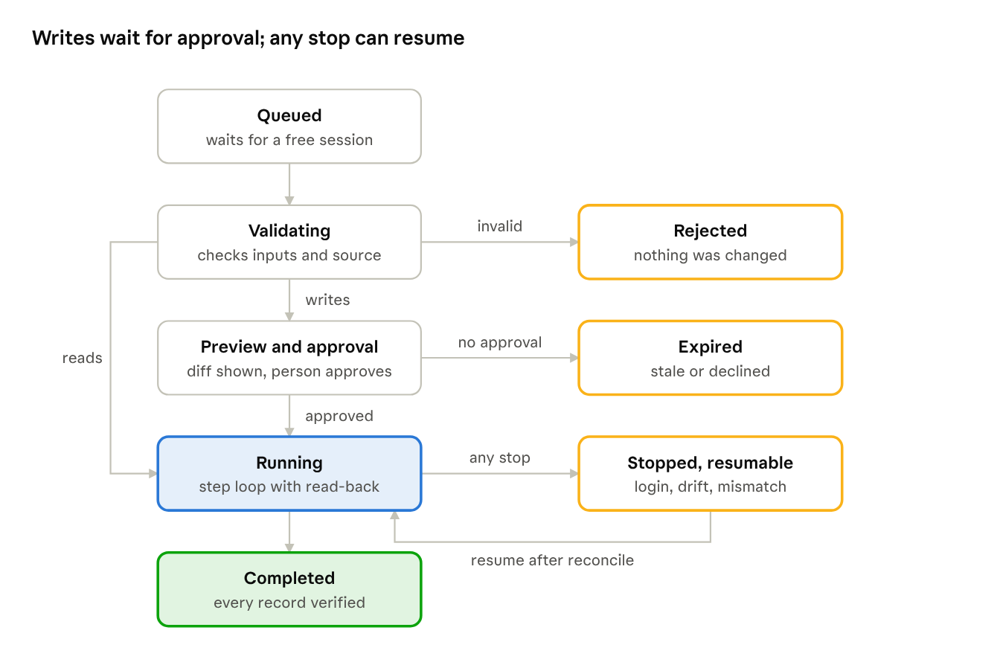

# 10. Runs, ledger, and resume

Every run moves through a fixed set of states, and a ledger written before each action makes any stopped run resumable without duplicates.

Reads skip preview and approval. Writes cannot reach Running without an approved diff, and a stopped run re-enters Running only after reconciliation.

**The ledger** is a small local database with a simple state machine. Each commit point a run makes, which is one save in the application, has one row:

| State | Meaning | On resume |
| --- | --- | --- |
| `planned` | Known from the source, nothing done | Proceed normally |
| `intent` | Intended values recorded; about to act | Reconcile first |
| `acted` | Write sent; confirmation not yet seen | Reconcile first (`possible_commit`) |
| `verified` | Read back and matched | Skip |
| `failed` | Stopped with a failure class | Reconcile, then retry if the class allows |

Each row also holds the record key, the intended and observed values, the attempt count, and a link to its evidence.

**Reconcile before write.** The app has no transactions, so a crash between clicking Save and recording it is unavoidable. On resume, the engine reads the record's current state by its key. If it already matches the intended values, the row is marked verified with no write. If not, the upsert runs again. Because writes are keyed upserts, running one twice is harmless.

**Records with no natural key** cannot be reconciled safely unless the operation declares another way to find them; [section 50](50-record-identity-and-dependent-records.md) defines those ways. A pipeline that creates them must store its own key in the app, such as a source id in a reference field; otherwise the create is classed `irreversible`, needs per-run approval, and is never resumed automatically.

**Run identity.** An unfinished run is identified by its caller, tool version, and input hash. The same caller calling the same tool with the same inputs while that run is unfinished gets that run back instead of starting another.

[Section 42](42-run-ledger-design.md) gives the full design: every state, the rules that must always hold, and the exact resume procedure. It adds the record state `unchanged` and a third outcome on resume, for a record that matches neither the intended values nor the values seen before the write.

A first research pass found that durable-execution engines give no stronger guarantee for writes to an outside system than this design does ([research note 13](../research/13-ledger-leases-and-runner-links.md)); a fuller check remains open for phase 3.
