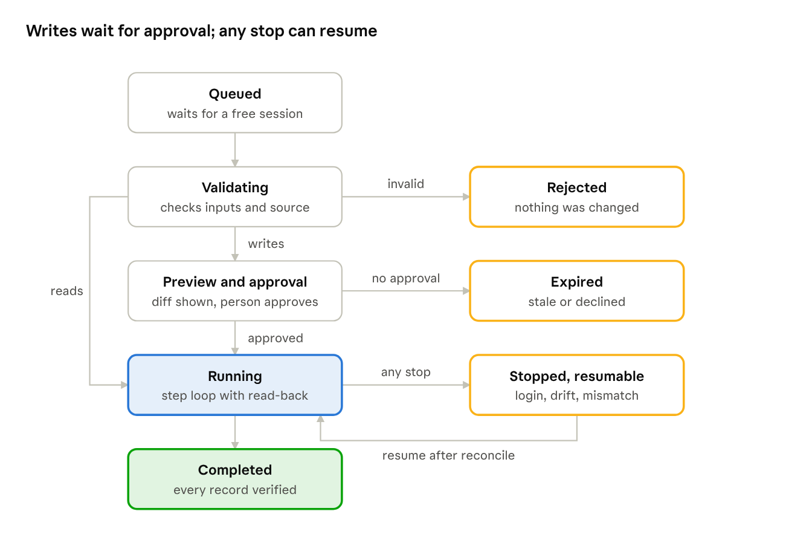

# 208. Runs, the ledger, and resume

Every run moves through a fixed set of states, and a ledger written before each action makes any stopped run resumable without duplicates. The ledger is the part of Anything2MCP that makes a write safe to stop, resume, and audit. This section says what is stored, the states each thing moves through, the rules that must always hold, and the exact procedures for the preview, the write, and resume. The table definitions are in the [ledger schema reference](../../reference/ledger-schema.md), and the code that keeps them is designed in [`a2m-ledger`](../../architecture/crates/a2m-ledger.md). The engine's side of the same procedures is in [`a2m-engine`](../../architecture/crates/a2m-engine.md) and [section 207](207-the-engine-loop.md).

## The problem it solves

No engine can make a write to someone else's system happen exactly once. Durable-execution systems say so themselves: the step that touches the outside world may run more than once, so the effect has to be given an identity before it runs and that identity reused on every retry ([research note 13](../../research/13-ledger-leases-and-runner-links.md)). Payment interfaces solve this by accepting an idempotency key. Most systems Anything2MCP latches onto accept nothing of the kind, and few offer a transaction that spans the write and its record of it, so a crash between the save and recording it cannot be ruled out.

Anything2MCP therefore builds the same guarantee from three parts it controls:

1. **Identity before action.** Each write is tied to a record key and recorded as an intent before anything is sent.
2. **Read instead of trust.** After a stop, the engine reads the record back from the system to learn whether the write landed.
3. **Keyed upserts.** Writing the same values to the same key twice leaves the same result, so running one twice is harmless.

The same research found that durable-execution engines give no stronger guarantee for writes to an outside system than this design does.

## What is stored

| Thing | One row per | Purpose | Owned by |
| --- | --- | --- | --- |
| Run | Call of an operation or pipeline | The unit a caller sees and holds a `run_id` for | `a2m-ledger` |
| Step | Pipeline step within a run | Order, chosen binding, and timing | `a2m-ledger` |
| Record | **Commit point in the system** | The ledger proper: what was intended, what was seen, how far it got | `a2m-ledger` |
| Event | Thing that happened | Append-only history; the source for traces, streams, and webhooks | `a2m-ledger` |
| Record lock | Record being written | Keeps two runs off the same record | `a2m-ledger` |
| Blob | Piece of evidence | Values, snapshots, and traces, stored once | `a2m-ledger` |
| Outbox entry | Message owed to the outside | Webhooks and notifications that must not be lost | `a2m-ledger` |
| Approval | Decision by a person | Binds a person to one exact diff ([section 212](212-policy-and-approvals.md)) | `a2m-policy` |
| Job | Piece of a run handed to a runner | Scheduling and leases ([section 223](223-the-runner-protocol.md)) | `a2m-sched` |

The store also holds published versions and their plans, findings, and the audit chain. Every table has one owning crate, and no crate's SQL names another's table, with one declared exception: when writes begin, the ledger checks the approval that policy recorded, in the same transaction (rule 3 below).

**One record row is one commit point.** A commit point is the moment the system itself saves: one Save click, one PUT request, one file replaced, one message published, one frame written. If an operation saves twice, for example on two tabs of a form, it has two rows. This rule is what makes resume exact, because every row is either saved in the system or not.

**Events and current state are written together.** Every change appends an event and updates the current-state row in the same database transaction, with no gap in the event sequence. The current state can always be rebuilt from the events, and a test does exactly that.

## Run states

| State | Meaning | Leaves by |
| --- | --- | --- |
| `queued` | Accepted, waiting for a session or runner | Scheduler |
| `validating` | Checking inputs and source; reading current values; building the diff | Engine |
| `rejected` | Inputs invalid; nothing was changed | Final |
| `needs_approval` | Diff ready; waiting for a person | Approval, expiry, or cancel |
| `expired` | Approval declined or timed out | Final |
| `running` | Steps executing | Engine |
| `needs_input` | A declared decision point is waiting for a person | Input or cancel |
| `needs_login` | The session expired and could not renew itself | Sign-in |
| `stopped` | Halted with a failure class; can be resumed | Resume or cancel |
| `completed` | Every record verified or unchanged | Final |
| `failed` | Halted and cannot be resumed | Final |
| `cancelled` | Stopped at a person's or caller's request | Final |

The `status` a caller sees is this state. Reads skip the preview and approval, going from `validating` straight to `running`. Writes cannot reach `running` without an approval of their diff, unless policy pre-approved them. A stopped run re-enters `running` only after reconciliation. Resume does not create a new run: the same run gets a new attempt number and a new lease.

**Run identity.** An unfinished run is identified by its caller, tool version, and input hash. The same caller calling the same tool with the same inputs while that run is unfinished gets that run back instead of starting another (rule 6).

## Record states

| State | Meaning | On resume |
| --- | --- | --- |
| `planned` | Known from the source; nothing done | Proceed |
| `unchanged` | Already equals the intended values; no write needed | Skip |
| `intent` | Intended values recorded; about to act | Reconcile |
| `acted` | Write sent; no confirmation recorded yet | Reconcile (`possible_commit`) |
| `verified` | Read back and matched | Skip |
| `failed` | Stopped with a failure class | Reconcile, then retry if the class allows |

Each row holds the record key, a digest of the intended values, the values seen before the write, the values seen after, the binding used, the attempt count, any key the system assigned and outputs recorded before the commit point ([section 209](209-record-identity-and-dependent-records.md)), and links to evidence. The values seen before the write are what make undo possible ([section 604](../6-running-it/604-management-and-operations.md)).

## Rules that must always hold

These are written as tests, and a change that breaks one cannot merge. Each is enforced by `a2m-ledger` where the data is, not by callers' good behavior.

1. **Intent before action.** A record reaches `acted` only if its `intent` was durably stored before the write was sent.
2. **Proof before verified.** A record reaches `verified` only with a value read from the system that equals the intended value after normalization, and a link to that evidence.
3. **Approval bound to the diff.** A write run first enters `running` only with an approval whose diff hash (defined in [steps, snapshots, and diffs](../../reference/steps-snapshots-and-diffs.md#diffs)) equals the run's, that is unexpired and unused, or with a recorded policy decision that allowed this run to write without a person. Marking the approval used and changing the run's state happen in one transaction. A resumed run is the same run: it continues under the approval it has already used and writes only what that diff holds, with rule 5 and the freshness check guarding each record.
4. **One writer per run.** Only the holder of the run's current lease number may change its records. Anything carrying an older number is refused.
5. **Reconcile after any doubt.** After a lease is lost or an engine stops, no record of that run is written until it has been read back. The ledger refuses to store a new intent while any record of the run is in `intent` or `acted` under an older lease number, so there is no flag to forget to set.
6. **One run per identical call.** At most one unfinished run exists for the same caller, tool version, and input hash. A second identical call returns the first run. For a file input the hash covers the file's content, not its path.
7. **One lock per record.** At most one run holds the lock for a record key in a target and environment.
8. **Final means final.** A run in a final state never changes again.
9. **History is append-only.** Events are never updated or deleted, except by the retention job, which removes whole runs. Triggers installed by the migrations refuse anything else.

## The intent token

When an intent is durably stored, the ledger returns an **intent token**: proof, as a type, that this record's intent is on disk under the current lease. It carries the run, the record key, the lease number, the digest of the intended values, and the record's idempotency token. Only `a2m-ledger` can make one. It cannot be copied, serialized, or kept: marking the record `acted` consumes it.

The token is the write gate. The engine receives it through `Control`, and the driver's handle in `a2m-provider` refuses a step that commits without one, so no driver can be called for a write whose intent is not stored. In one process the type is the guard. Across the runner link the ledger is: a runner rebuilds the token from the control plane's acknowledgement, and the ledger refuses to mark `acted` a record whose row is not in `intent` under the same lease number and intent event, so a forged or replayed acknowledgement changes nothing.

## The preview, step by step

A write run builds its diff while it is `validating`, before anyone is asked to approve.

1. Validate the inputs and read the whole source ([section 210](210-sources-and-value-normalization.md)). A file is read once and stored as a blob ([section 502](../5-security/502-defending-against-a-manipulated-agent.md)).
2. Apply the record limit and quotas ([section 212](212-policy-and-approvals.md)).
3. Run the read steps that come before the first write step, checking each `expect`. A failure here ends the run before anyone is asked to approve. Read steps after the first write step run only in the write phase.
4. For each record the write steps would touch: evaluate its inputs, look the record up by its identity strategy, and class it `create`, `update`, or `unchanged` ([section 209](209-record-identity-and-dependent-records.md)). For `natural` and `composite` identity the lookup is the read-back rule of the binding that will write the record, used on its own. The values found are kept as the values seen before the write.
5. Build the diff, hash it by the canonical form in the reference, and store both on the run. The engine computes the hash and nothing else does, so an approval and a run can never disagree about it.
6. If the diff holds nothing to create or update and the tool has no other effect, such as an upload, no approval is needed: the run writes nothing, runs its remaining read steps, and ends `completed`. This is what makes a second run of the same sheet change nothing. Otherwise the policy engine is asked whether the write may proceed without a person, and the run waits at `needs_approval` if not.

**An operation with no current value.** Some writes have nothing to look up: a message published to a stream, for example, is a new thing every time. Such a record has no values seen before the write, is classed `create` in every diff, and the approver sees its proposed values only. Where the system does keep a current value, such as a channel that holds the latest message for each key, the lookup reads it as for any other record ([section 309](../3-packs/309-the-stream-pack.md)).

## The write path, step by step

An execute begins by consuming the approval bound to the diff hash, which moves the run to `running` in one transaction (rule 3). It then runs the leading read steps again, and stops with `unknown_variant`, `expect_failed` if an `expect` that held at the preview fails now: approval can take minutes, and the diff was approved on what those reads showed.

Then, for each record in a write run:

1. Take the record lock.
2. If the preview is older than the freshness window (60 seconds by default), or policy is strict, read the record again and compare it with what the preview saw. A difference stops the run with the class `stale` and the code `changed_since_preview`, because the approved diff no longer describes what would happen.
3. Store the intent and receive its token. In a single process this is one synchronous database commit; on a split deployment the runner waits for the control plane's acknowledgement.
4. Act: one commit point in the system, sent with the token, and only while the job's lease covers the step's time limit.
5. Mark `acted`, with any key the system assigned.
6. Read back, normalize, compare. Mark `verified`, or stop with `mismatch` after one re-read.

The ledger releases the record's lock itself, in the same transaction that marks it `verified` or `unchanged`. There is no separate unlock.

**Intent window.** Waiting for an acknowledgement per record costs a round trip. A runner may therefore store intents for several upcoming records at once. The default is set per mode, by `intent_window` in its provider's manifest ([section 201](201-archetypes-and-modes.md)); in the first packs, for example, one for driving an interface and eight for direct requests. If a runner stops, at most that many records are in `intent` and need a read on resume. Nothing is lost, because an intent is only a claim that a write may have been sent.

**Idempotency tokens where the system takes them.** Each record carries a stable token derived from the run and the record key, held in its intent token. When a surface documents an idempotency key, the binding sends the token, so the system itself refuses a duplicate. The same token is the stamp for `stamped` identity ([section 209](209-record-identity-and-dependent-records.md)).

**Version checks where the system offers them.** If the system exposes a record version, such as an `ETag` or a version field, the binding sends it as a precondition. A change by someone else then fails cleanly as `stale`, `version_conflict`, instead of being overwritten.

## Resume, exactly

When a run is resumed, for each record in `intent`, `acted`, or a retryable `failed`, in key order:

1. Take or confirm the record lock under the new lease.
2. Read the record's current values.
3. Compare, after normalization:

| Current values equal | Meaning | Action |
| --- | --- | --- |
| The intended values | The write landed | Mark `verified`; write nothing |
| The values seen before the write | The write did not land | Return the record to `planned` and continue |
| Neither | Someone else changed the record, or the system applied part of the write | Stop with `stale`, `changed_since_preview`; a new preview and approval are needed for that record |

How the record is read depends on how it is found again:

| Identity strategy | How the record is read |
| --- | --- |
| `natural`, `composite` | The binding's read-back steps alone, from the identity inputs |
| `stamped` | The lookup by the record's token |
| `find` | The declared lookup. More than one match stops with `possible_commit`, `ambiguous_match`; zero matches waits the settle time out once and looks again |
| Any, once a key was assigned | By the assigned key |
| Any, with outputs recorded before the commit point | By what was recorded: a key assigned inside an open transaction, or the digest a file would have |
| `none` | Cannot be read. The run is never resumed by itself and stops for a person |

Only after every doubtful record is settled does any write run. Records in `planned` then continue through the normal write path; records in `verified` or `unchanged` are skipped. A record in doubt is read through the mode its intent was stored for, and never through another. A dependent record takes its parent's assigned key from the ledger and never runs the parent again.

**Records with no way to be found again cannot be read back,** so they cannot be reconciled. An operation that creates them is classed `irreversible`, is approved per run, and is never resumed automatically. A pipeline that creates such records avoids this by storing its own key in the system, such as a source id in a reference field; [section 209](209-record-identity-and-dependent-records.md) gives the ways.

**Who resumes.** A run stopped by the engine's own death is resumed by its caller with `run.resume`, never by the engine alone at its next start. A job whose lease ended without a result is treated as `possible_commit` and reconciled before anyone else gets it ([section 223](223-the-runner-protocol.md)).

**Checking after a lost lease.** A later check reads every record the ledger says was verified in a run whose lease was lost, and reports any difference as evidence and an alert. It changes no state.

## Failure classes and run states

The class alone decides what happens next ([section 207](207-the-engine-loop.md)). This table says which run state each class ends in, and what becomes of the lock on a record left in `intent` or `acted`.

| Class | Run state | Lock on a record in `intent` or `acted` |
| --- | --- | --- |
| `input` | `rejected` before anything ran; `failed` once the run is `running` | None is held |
| `policy`, `stale` | `failed` | Released by the ledger; nothing is in doubt once read |
| `session_expired` | `needs_login` | Quarantined |
| `transient` after retries, `busy`, `mismatch`, `edge_blocked`, `unknown_variant`, `rejected` | `stopped` | Quarantined if a record is in doubt, released otherwise |
| `drift` | `stopped`, and pinned to the plan that drifted | As above |
| `possible_commit` | `stopped` | Quarantined until reconcile |

The class `rejected` (the system refused the input) and the run state `rejected` (the inputs were invalid before anything ran) are different things; the first ends in `stopped`.

**After the save was sent.** A record whose committing step was sent is failed with `policy`, `stale`, or `input`, the classes that release its lock, only when the system itself answered that it refused the write: `stale` for the version sent with it. Any other failure of those classes between the save and `verified`, in the save's own answer, a confirm step, or the read-back, is `possible_commit`: the lock is kept and reconcile decides. The engine holds this whatever a driver reports ([decision 0147](../../decisions/0147-the-engine-after-its-safety-audit.md)).

A run stopped as `stale` ends `failed`, because resuming could never succeed: its approved diff no longer describes the system. It is therefore final, and rule 6 does not hand it back to an identical call; that call starts a new run with a new preview.

**Cancel.** On cancel the engine finishes the commit point it is in, records it, and stops; a read stops at once. A commit point is never abandoned halfway. The record it finished is either verified, which releases its lock, or stopped with a class, and the table above applies.

## Reads

A read has a run row and events but no record rows. Reads are recorded for audit without forcing a disk sync on every call, so the ledger adds well under a millisecond to a read. Writes always sync at intent.

## Locks

Record locks belong to the ledger, because storing an intent must check the lock in the same transaction. The scheduler only queues the wait ([section 211](211-concurrency.md)).

- A lock names a workspace, target, environment, and record key, and its holder's run and lease number.
- It is taken just before the intent and released by the ledger when the record is verified or unchanged, so a long pipeline holds one lock at a time, not all of them.
- A second run that needs a locked record waits in the queue up to a limit, then returns `busy`, `record_locked` with a retry time.
- A lock is `held` or `quarantined`. When a lease is lost, or a run stops with a record in doubt, the locks for those records are quarantined, not released. They pass to reconcile, so no other run can write those records before they have been read back.

## Evidence and retention

- Values, diffs, snapshots, and traces are stored as blobs, sealed through the vault ([section 216](216-the-vault-and-its-keys.md)), and referenced from rows. Identical evidence within a workspace is stored once.
- A blob is named by the workspace's keyed digest of its plain content, never by its plain hash, so someone who can read the store cannot confirm a guessed value by hashing it. A digest that must be the same on every machine, such as a diff hash or a plan hash, is never a blob name.
- A blob is synced to disk before the row that names it commits. A blob whose row never committed is collected by retention.
- Each blob has a retention class: short for traces and screenshots, longer for diffs and before-and-after values, longest for the audit log.
- A retention job deletes whole runs and their unreferenced blobs once they are past their class. Legal hold on a run suspends it.
- Values classified as sensitive are stored only as hashes unless policy allows the values themselves, which limits undo for those fields.
- Event payloads, audit entries, and failure messages pass the redactor before they are written.

What a trace and its evidence contain is [section 217](217-traces-evidence-and-repair.md).

## One schema, two databases

| Concern | SQLite (local profiles) | Postgres (servers) |
| --- | --- | --- |
| Claiming a job | One writer at a time; an immediate transaction | An atomic update that selects with `FOR UPDATE SKIP LOCKED`, the standard pattern for database queues |
| Waking a waiting worker | An in-process signal | `LISTEN` and `NOTIFY`, with polling as the fallback |
| Clock | The process's clock | The database clock, so replicas agree |
| Structured columns | Text holding JSON | `jsonb` |
| Blobs | Files beside the database | Object storage, or the database for small ones |
| Durability of an intent | Synchronous commit in write-ahead mode | Synchronous commit |

Migrations are numbered, forward-only, one sequence for the whole schema, each naming the crate that owns its tables, and run against both databases in CI. Identifiers are time-ordered UUIDs, shown to callers with a short type prefix such as `r_` for runs. Without a store that can commit, nothing writes ([section 224](224-when-the-engine-itself-fails.md)).

## What this does not solve

- **A write the system applied partly.** The third row of the resume table detects it and stops; a person decides.
- **A stale runner writing after its lease was lost.** The ledger refuses its updates, but the system cannot. [Section 223](223-the-runner-protocol.md) describes how the window is narrowed and what remains.
- **A change made by someone else between read-back and the end of the run.** The run verified what it wrote at the time it wrote it; it does not own the record afterwards.

## Speed targets

Storing an intent: under 2 ms locally and under 5 ms to a control plane on the same network. Ledger overhead on a read: under 1 ms. Both are targets until measured in Phase 3 ([section 225](225-performance.md)).

## Open points

- **What a write step's inputs may depend on.** A proposed value has to be known at the preview to be approved. A write step whose inputs use the result of a read step that runs after an earlier write cannot be previewed. The compiler should refuse it, and no rule says so yet. An earlier write step's assigned key is the one case section 209 already covers.
- **The failure class to run state table** is as the engine carries it out, recorded in [decision 0091](../../decisions/0091-the-engine-loop-as-its-first-two-passes-settled-it.md).
- **The intent window across bindings** in one pipeline step, when records of two bindings interleave.
- **Durability on SQLite** is a setting changed per transaction on the one writing connection ([decision 0080](../../decisions/0080-the-store-is-one-sqlite-file-and-a-crate-reaches-its-own-tables-through-the-transaction.md)). Its cost is still to be measured against hypothesis H-15.
- **Whether run rows of reads are summarized at scale.** It follows the open point on sampling decisions in [section 212](212-policy-and-approvals.md).
- A fuller check of durable-execution engines against this design remains open for Phase 3.
