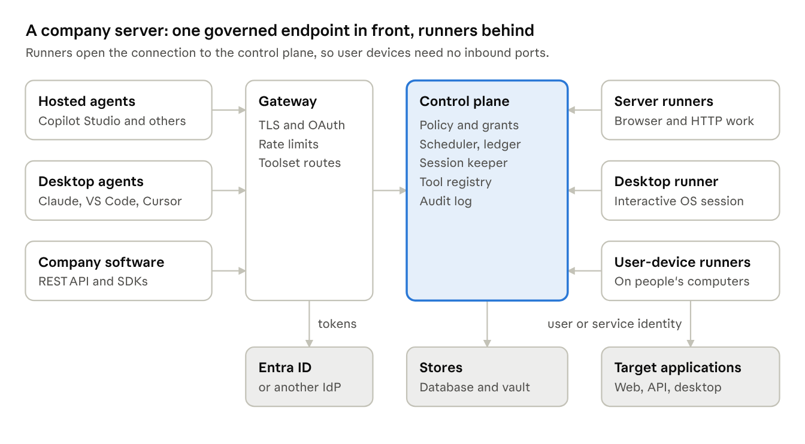

# 23. Deployment configurations

One binary covers every setup, from a single laptop to a company-wide service. Roles are switched on by configuration, and target files are identical in all of them.

| Profile | Shape | Who connects | Stores | Typical identity modes |
| --- | --- | --- | --- | --- |
| **Solo** | One engine process per user, started on demand by the first command or MCP client and stopped when idle ([section 39](39-local-engine-and-clients.md)) | That user's agents | One SQLite file, OS key store | The user's existing sign-in |
| **Workstation service** | One background service on the machine, with local HTTP as well as stdio | Several agents and apps on that machine | SQLite, OS key store | The user's existing sign-in |
| **Team server** | Control plane and runners in one process on one VM | A team, over the network | SQLite or Postgres | Service account; per-user session or token |
| **Company server** | Control plane on a dedicated VM, a pool of server runners, optional desktop runners, behind a gateway | The organization's users, hosted agents such as Copilot Studio, internal software | Postgres, object storage for traces, an external secrets manager | All four |
| **Hybrid** | Company control plane, with runners on users' own computers | Organizations whose sign-ins are bound to managed devices | As company server | `per_user_device` |
| **Cluster** | Several stateless control-plane replicas, autoscaled runner pools, highly available database | Large organizations | As company server, replicated | All four |
| **Embedded** | The engine as a library inside another application | That application | The host application's choice | Supplied by the host |

In the company profile, every caller reaches one governed endpoint. The control plane never touches a target itself; runners do, as the user or as a service account.

**Why this scales cleanly.**

- **Stateless front.** MCP no longer has protocol sessions, and Anything2MCP keeps all run state in the store under a `run_id`. Any control-plane replica can answer any request, so no sticky routing is needed.
- **Runners pull work.** Runners connect outward and take jobs suited to them: by target, by mode, by operating system, and by identity. Adding capacity means starting more runners.
- **Sessions live with runners, secrets with the vault.** A live browser stays on its runner; its saved state is encrypted in the vault so another runner can take over after a restart.

**Build once, promote anywhere.** Tools are usually built in the Solo profile on someone's laptop, then promoted. `anything2mcp bundle` packs a target version into a signed file; the company server's publisher reviews and imports it, or the server pulls it from a Git repository. Nothing is rebuilt, because the files are the same in every profile.

**Operating systems.** The control plane and server runners run on Linux, Windows, and macOS, natively or in a container. Desktop runners need an interactive session on the operating system of the app they drive. User-device runners install as a small tray application.
